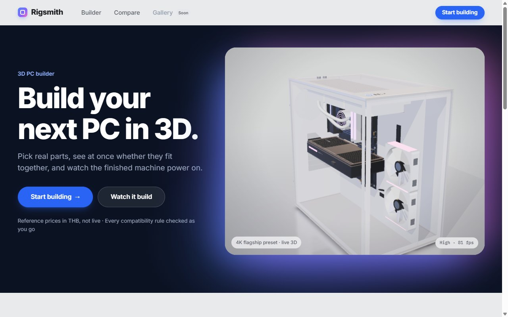
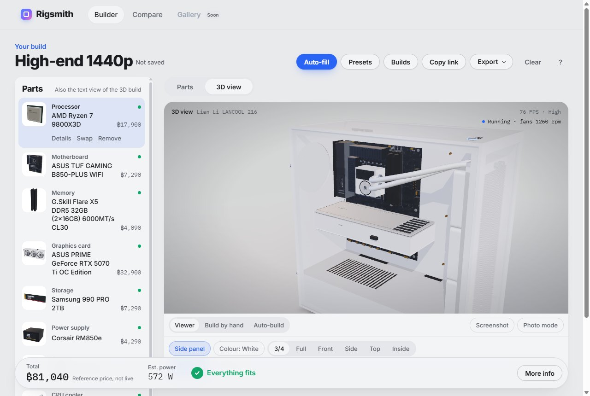
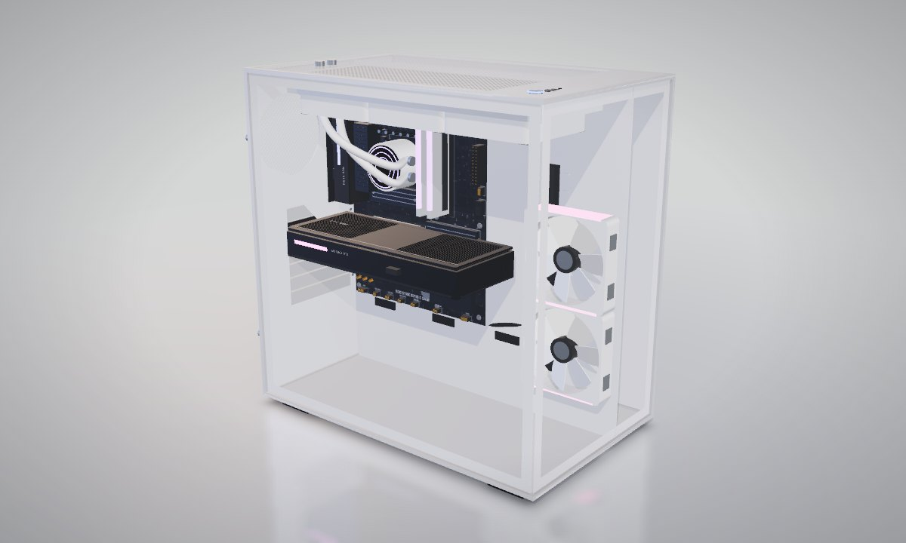
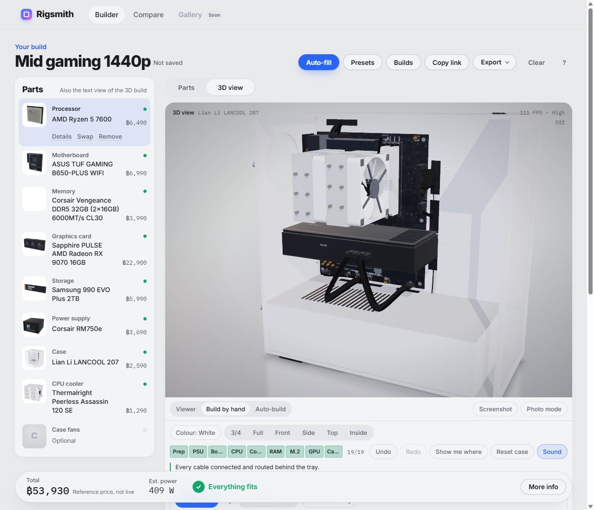
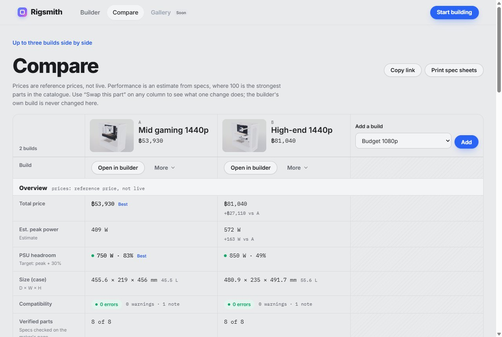
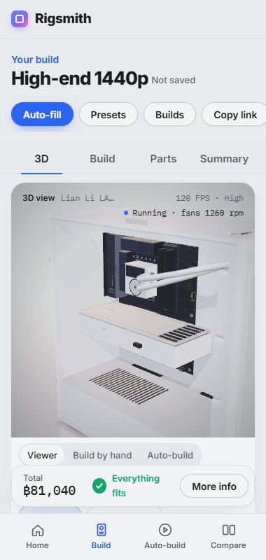

# Rigsmith

**A 3D PC builder that runs in the browser.** Pick real parts, see straight away whether they fit together, then build the machine in 3D: place every part and plug in every cable yourself, or press Auto-build and watch it assemble itself and power on.

**Live demo:** [https://rigsmith.netlify.app](https://rigsmith.netlify.app) (placeholder until the first Netlify deploy)



## Screenshots

| | |
|---|---|
|  |  |
| **Builder.** Parts list, live 3D view, and a summary bar with the total, the estimated power draw and the compatibility status. | **3D view.** Physically based materials, studio lighting, fans spinning, RGB lit. Glass panel, exploded view, colour themes and camera presets. |
|  |  |
| **Build by hand.** Install the parts in the real order, then connect every cable (24-pin, EPS, PCIe, SATA, front panel) and get a cable-management score. | **Compare.** Up to three builds side by side: price, estimated performance per workload, power draw, PSU headroom and case size. |



On phones the 3D view comes first, with tabs for the build, the parts and the summary, and a bottom navigation bar.

## Key features

- **Large real catalogue:** 342 real products across 9 categories (CPU, motherboard, memory, graphics card, storage, PSU, case, CPU cooler, case fans). Specs come from the makers' pages; any spec that couldn't be confirmed is left empty and the part is marked as unverified, never guessed.
- **Live compatibility check:** every pick is checked against the rest of the build, and parts that wouldn't fit are greyed out with the reason.
- **Three ways to build:** pick parts and view the result, build it by hand in 3D (parts, then cables), or Auto-build with a cinematic camera.
- **Realistic 3D:** every part is modelled in code from its real dimensions (1 unit = 1 cm): perforated case panels, boards with VRM heatsinks and slots, RAM with heatspreaders, GPUs with shrouds and fans, AIOs, tower coolers, PSUs and SSDs. Studio lighting is baked into the environment map, so the High setting stays smooth on integrated graphics.
- **Presets, saved builds and sharing:** 8 complete preset builds, builds saved in the browser, share links, printable spec sheets, and a screenshot / photo mode.
- **Performance estimate:** a score per workload (1080p, 1440p and 4K gaming, video editing, AI, general use), where 100 is the strongest parts in the catalogue. The method is written up in [docs/perf-model.md](docs/perf-model.md).
- **Honest prices:** reference prices in THB, always labelled "reference price, not live", with a "Search this part" link instead of fake store listings.
- **Accessible:** real buttons and labels, keyboard shortcuts for builder actions, visible focus, reduced-motion support, and the parts list doubles as the text version of the 3D scene.

## How the compatibility engine works

The engine is a set of small rules. Each rule looks at the whole build and returns a list of problems. Every problem has a level, the parts involved, a plain-English message and, where possible, a fix.

- **Error:** the build won't work, for example a CPU that doesn't fit the motherboard's socket, or a graphics card longer than the case allows.
- **Warning:** it works, but with a catch, for example a power supply with little headroom, or a board that needs a BIOS update before it can run this CPU.
- **Note:** the engine can't confirm something because a spec is unknown. An unknown spec never counts as a pass or a fail. The engine says what it couldn't check and lets the build continue.

The rules are grouped by topic, one file each in `js/compat/`:

| Group | What it checks |
|---|---|
| Platform | CPU socket vs board, memory type (DDR4 / DDR5) and slots, capacity limits, and whether the board's launch BIOS supports the CPU generation |
| Cooling | Cooler socket support, tower height vs case clearance, radiator size vs case mounts, cooling capacity vs CPU power |
| Fit | Board size vs case, GPU length (minus a front radiator) and thickness, PSU size, fan mounts |
| Power | Estimated peak draw vs PSU wattage (target: 30% headroom), GPU and CPU power connectors |
| Storage | M.2 slots, SATA ports, drive bays, SATA power plugs |
| Essentials | Missing parts, and whether there's a display output (no graphics card and no integrated graphics) |

The same rules grey out parts in the catalogue: to test a part, the engine adds it to a copy of the build and keeps only the problems that involve that part. The rules are plain functions with no UI code, so `node tools/test-compat.mjs` tests them directly.

## Tech

- Plain HTML, CSS and JavaScript (ES modules). No framework, no build step.
- [three.js](https://threejs.org) r170, vendored in `vendor/` and loaded through an import map: PBR materials, PMREM environment lighting, bloom, shadows.
- Static hosting on Netlify (`netlify.toml`): long-lived caching for versioned CSS/JS (`?v=<hash>` stamped by `tools/stamp-version.mjs`), no-cache for HTML.
- Testing: Node scripts for data validation and logic, plus headless Chrome tests driven over the DevTools protocol (no npm packages).
- Part data in `data/parts/*.json` is the single source of truth. The UI never hard-codes part names.

## Run it locally

You need [Node.js](https://nodejs.org) 22 or newer. Nothing to install.

```
git clone https://github.com/dilshangulati07-crypto/rigsmith.git
cd rigsmith
node tools/serve.mjs        # http://localhost:8000
```

Any static server works. This one sends `Cache-Control: no-store`, so module changes show up when you reload.

## Tests

Node tests (fast):

```
node tools/validate-data.mjs
node tools/test-compat.mjs
node tools/test-layout.mjs
node tools/test-assembly.mjs
node tools/test-cables.mjs
node tools/test-autobuild.mjs
node tools/test-cinematic.mjs
node tools/test-presets.mjs
node tools/test-share.mjs
```

Browser tests run in headless Chrome (set `CHROME=<path>` if it isn't found). Add `-v` to print passing checks and `--shots <dir>` to save screenshots:

```
node tools/test-browser.mjs
node tools/test-realism-browser.mjs
node tools/test-share-browser.mjs
node tools/test-cinematic-browser.mjs
```

The browser tests use Chrome's software renderer (SwiftShader), so results match on every machine but run slowly. `test-browser` takes over 10 minutes. `test-cinematic-browser` plays four full Auto-build sequences at about 11x slower than real time, so expect 20 minutes or more.

After changing CSS or JS, run `node tools/stamp-version.mjs` (`--check` verifies) before committing.

Images are rendered from the real 3D scene: `tools/render-features.mjs` (landing cards), `tools/render-share.mjs` (hero poster, share image, touch icon, WebP copies), `tools/render-readme.mjs` (these screenshots) and `tools/render-makeover.mjs` (design review at 1280, 768 and 380 px).

## Deploy

The site is static, so Netlify deploys it straight from GitHub with no build command (see `netlify.toml`). After the first deploy, put the live address into the canonical links, share tags, sitemap and this README with:

```
node tools/set-site-url.mjs https://your-site.netlify.app
```

## Credits

- Studio lighting: [Studio Small 08](https://polyhaven.com/a/studio_small_08) by Sergej Majboroda, Poly Haven, CC0.
- Rendering: [three.js](https://threejs.org), MIT.
- Fonts: [Inter](https://rsms.me/inter/) and [IBM Plex Mono](https://github.com/IBM/plex), SIL Open Font License.
- 3D parts are modelled in code. Any downloaded models are listed in [models/CREDITS.md](models/CREDITS.md).
- Product names and specs belong to their makers. Prices are approximate reference prices, not live.

Built by Dilshan Gulati as a final-year IT portfolio project.
